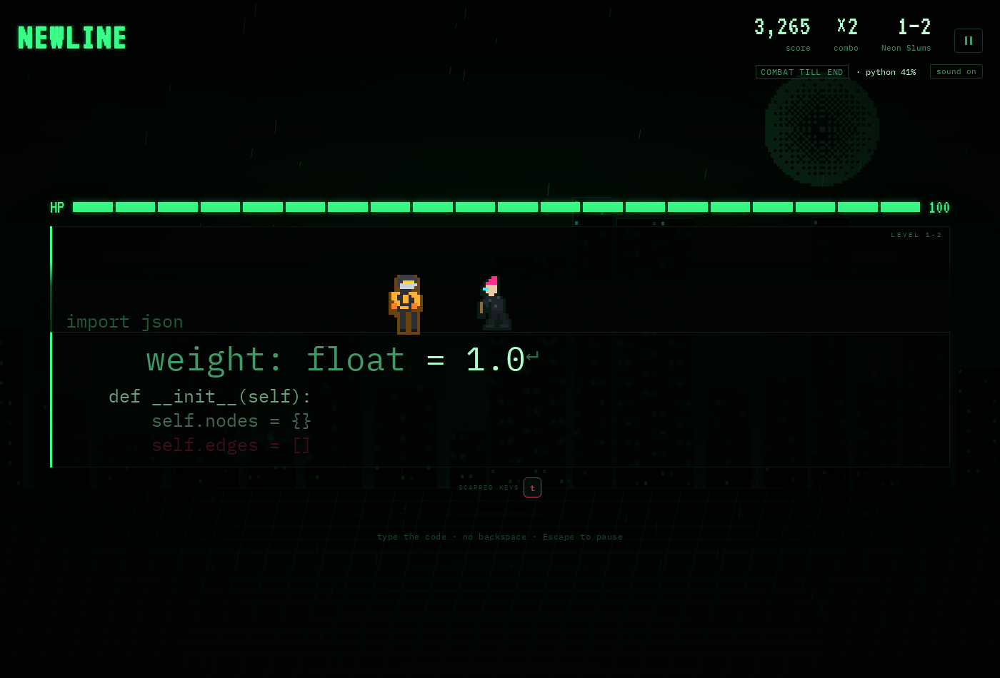
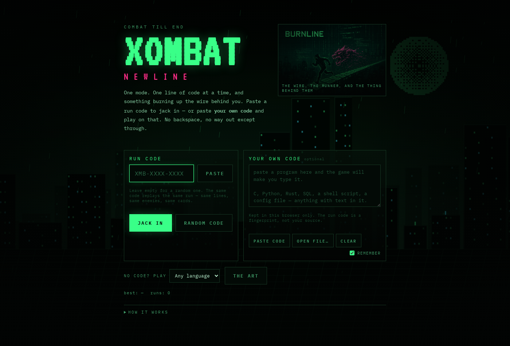
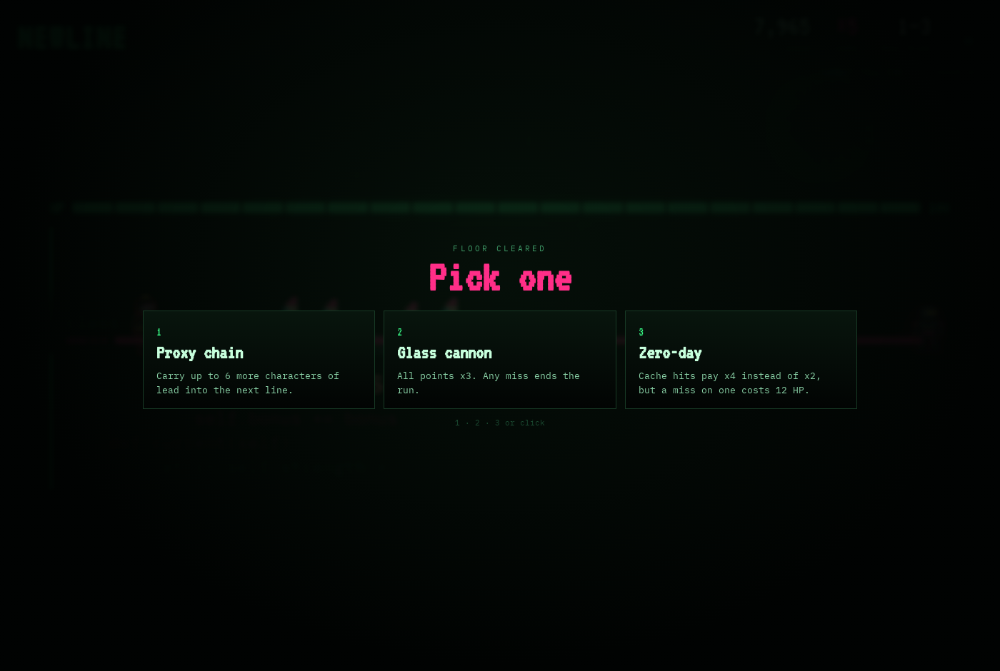
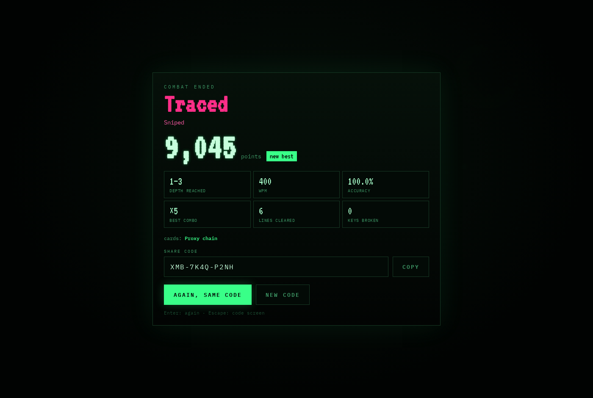
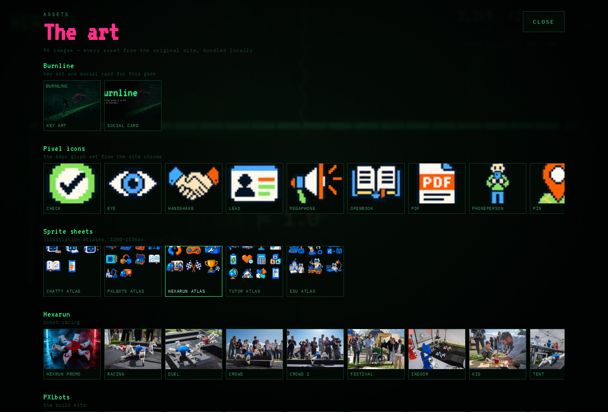
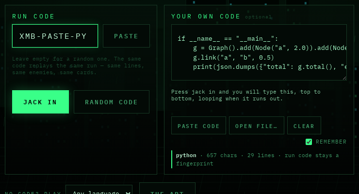
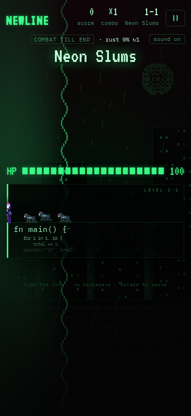

# XOMBAT — Newline

A static, single-mode rebuild of [Burnline](https://crazybots.io/burnline/) — the hardcore typing
roguelike where you type Python ahead of an ICE trace and there is no backspace.

**One mode: combat till end.** Paste a run code, jack in, and survive as long as your fingers hold
out. There is no stage select, no practice, no leaderboard, no backend. It is a folder of HTML, CSS
and JS that runs from `file://` or any static host.

Your fighter stands at the cursor and throws a punch for every character; each character of the
line is a creature of the zone you are in, waiting to be typed to death. (Those sprites are the
original's own pixel matrices — see *the art*, below.)

Two ways to get text into a run:

- **A run code** (`XMB-7K4Q-P2NH`) — the shipped corpus, replayable by anyone.
- **Your own code** — paste a program into the box and the game makes you type *it*, top to bottom.
  C, Python, Rust, Go, SQL, a shell script, a config file, a novel: if it has text, it plays.

<p align="center">
  
</p>

## Play

```bash
# no build step, no dependencies, no server required
open index.html            # or: python3 -m http.server 8080
```

Then, on the gate screen:

1. **Run code** — paste the code you were given (or leave it empty / hit *random code*).
2. Optionally **paste your own code** in the right-hand box, or **open a file**.
3. **Jack in.**
4. Type the code on screen. Exactly. No backspace.

Your run code fully determines the run: the same code gives the same lines, the same enemies, the
same card offers, in the same order. A share code looks like `XMB-7K4Q-P2NH`, and `index.html?code=XMB-7K4Q-P2NH`
opens straight into that run. Any text works as a code — it is hashed into a seed — so `KEVIN` is a
legal code and so is a full sentence.

### Playing on your own code

Drop anything into **your own code**: paste it, open a file, or type it. The game

- **detects the language** (C, C++, Python, Rust, Go, Java, C#, Ruby, JS/TS, SQL, HTML, CSS, JSON,
  YAML, shell, markdown, or plain text) and names it in the HUD,
- keeps the document **in order**, wrapping long lines to the viewport and collapsing runs of blank
  lines to a single Enter,
- **loops** back to the top when it runs out, so "combat till end" still means something,
- turns *that language's* keywords into brutes, so `printf` and `struct` are enemies and not just
  letters,
- shows your **progress** through the document next to the level (`· c 36%`), and
- keeps your source in this browser only. The share code is a short **fingerprint** of the text, not
  the text: hand someone the code and they get the same run shape without getting your code.

`Tab` jumps the cursor over up to four spaces of indentation at once, and `Enter` finishes a blank
line — because real code is mostly whitespace.

| | |
|---|---|
| `A`–`Z` `0`–`9` punctuation `Space` | type |
| `Tab` | jump one indent (up to 4 spaces) |
| `Enter` | finish a blank line |
| `Escape` | pause / resume |
| `Enter` (result screen) | again, same code |
| `1` `2` `3` | pick a card |
| `Backspace` | *nothing*. It says so on the tin. |

## Screens

| gate | cards | result |
|---|---|---|
|  |  |  |

**The art.** Every image that ships with the original site — key art, social card, the 64px pixel
icon set, the five illustration atlases, and the Hexarun / PXLbots / Chatty / event photography — is
bundled under `assets/` and browsable in-game via **the art** button. 96 images, all local, no CDN.

<p align="center"></p>

<p align="center"></p>

Mobile works too — the file input trick opens the on-screen keyboard:

<p align="center"></p>

## The rules

The run is a descent. Every **floor** is three **waves**, every wave is three lines, and the third
line of a wave is a **boss line**. Clear a floor and you pick a card. There is no ceiling: at floor
11 the zones loop back to Neon Slums with everything turned up, forever.

**The trace.** A wall of fire eats the line from the left at a fixed speed. Type faster than it and
you live; the distance you are ahead at the end of a line is paid out as points and partly carried
into the next line as a head start. If it reaches your cursor you get caught — most zones just hurt
you and knock the trace back six characters, but Foundry, Orbital Relay and Kernel Core are *lethal*:
one touch ends the run.

**The line.** The text is real Python, dealt from a 34-snippet corpus. Characters are enemies:

| kind | what it is | what it does |
|---|---|---|
| `grunt` | a plain character | nothing, type it |
| `brute` | a whole keyword or long identifier, red | dies on its last letter, but a miss inside it costs **1.5×** |
| `sniper` | magenta, underlined wavy | aims for 3.2 s, then hits for 4 HP, then aims again |
| `bomber` | amber, blinking when armed | explodes 1.6 s after it becomes the next character for 10 HP |
| `berserker` | red | rips 8 HP every 1.2 s until you kill the character |
| `shield` / `juggernaut` | cyan / gold, overlined | needs 2 / 3 correct hits on the same character |
| `medic` | green, underlined | heal 4 HP when killed |
| `cache` | gold | pays 60× the combo multiplier |
| `splitter` | amber | its death turns two later characters into splitlings (each pays 20×, misses hurt 1.5×) |
| `summoner` | violet, dotted underline | every 4 s it armours a plain character ahead of you |
| boss | red, whole line | see below |

**Boss lines.** Every non-space character on a boss line shares one health bar, in three phases. The
boss hits you on a fixed cycle — 3.6 s, then shorter each phase — and the zone's own hazard keeps
running underneath. Three bosses cycle:

- **Amnesia** — the line blanks after a moment; you finish it from memory.
- **Metronome** — every key that lands more than 60% off your median key interval costs 2 HP.
- **Mirror** — every word is written backwards. Type it as you see it.

**Scars.** A key you get wrong gets *cracked*; get it wrong again and it is *broken* (mined). Mined
keys appear underlined everywhere on the line and cost double on a miss. Thirty clean keystrokes in
a row repairs one scar. Your mistakes literally change the text you are given.

**Cards.** After each floor, one of three:

| card | effect |
|---|---|
| Glass cannon | all points ×3, any miss ends the run |
| Heartbeat | every 12 steady keys heal 2 HP |
| Low bandwidth | you see only 5 characters ahead, points ×1.6 |
| Leech | clean words heal +3 HP, misses hurt 1.5× |
| Lag spike | trace 15% slower, points ×0.85 |
| Zero-day | cache hits ×4, a miss on one costs 12 HP |
| Proxy chain | carry 6 more characters of lead into the next line |
| Hotfix | keys repair after 20 clean characters instead of 30 |
| Reboot | heal to full |
| Overclock | trace 20% faster, points ×1.5 |

**Score.** `10 × combo` per character (combo steps 1, 1.5 … 5 every ten keys), bonuses for kills,
lead and clean lines — then multiplied by `accuracy⁴ × rhythm`, where rhythm is how even your key
intervals were. Type fast, type clean, type steady. The final number, the depth, the WPM and the keys
you broke are all on the result screen, along with the code to hand to someone else.

## Project layout

```
index.html            all five screens, one page
css/game.css          terminal aesthetic, colours, animations
js/core/rng.js        seeded stream (FNV-1a hash + mulberry-ish)
js/core/langs.js      language detection + per-language keyword sets
js/core/text.js       snippet dealing and line wrapping
js/core/source.js     pasted code -> playable lines (clean, wrap, loop)
js/core/setup.js      one place that decides what a run is made of
js/core/enemies.js    zones, hazards, the enemy roster, dressing a line
js/core/engine.js     the simulation — headless, no DOM
js/core/keys.js       scars: cracked and mined keys
js/core/cards.js      the upgrade deck
js/core/codes.js      run codes -> seeds
js/ui/game.js         screens, render loop, keyboard, persistence
js/ui/world.js        the pixel city behind the terminal (canvas)
js/ui/audio.js        all SFX synthesised with WebAudio
js/data/snippets.js   generated: the 34 Python snippets
js/data/packs.js      generated: 48 language packs, 370 snippets
js/data/sprites.js    generated: 35 foe matrices + 4 fighters, from the bundle
js/data/words.js      generated: 620 English words
js/ui/stage.js        the fighters: hero + one creature per character
js/ui/gallery.js      the asset browser
tools/sim-test.cjs    headless rule tests (node, no dependencies)
tools/extract-data.cjs  regenerates js/data from the original bundle
assets/fonts          IBM Plex Mono + VT323 (SIL OFL)
assets/music          two loops from the original site
assets/art, assets/img, assets/media   every image from the original site
docs/                 screenshots + the reverse-engineering notes
```

The engine is deliberately DOM-free, so the whole rule set is testable from node:

```bash
node tools/sim-test.cjs
```

67 checks: seed determinism, line wrapping, that brutes never cut a word in half, that a miss costs HP
and scars the key, that standing still gets you killed, that lethal hazards kill rather than damage,
that floors advance and offer cards, that the same code plays out identically twice and a different
code does not, that a flawless typist can go deep while a fallible one dies — plus, for pasted code:
that text is cleaned, ordered, width-wrapped and looping, that languages are detected, that every
line played came from your document, and that the share code carries no source text.

State lives in `localStorage` only: your best score, your run count, whether sound is on, and (if
**remember** is ticked) the code you pasted. Nothing is sent anywhere — there is no server to send it
to.

## How this was built

`docs/REVERSE-ENGINEERING.md` has the full teardown: what the original bundle contains, the exact
constants that were reused (trace speed, damage scales, combo curve, enemy timings, zone rosters,
the score formula), and what was deliberately left out with the reasoning.

## Credits

- Original game, design, text, music and fonts: [Burnline](https://crazybots.io/burnline/) by CrazyBots.
- This is a fan reimplementation for study; the code here is new, the rules and content are theirs.
- Fonts: IBM Plex Mono (IBM, SIL OFL 1.1), VT323 (Peter Hull, SIL OFL 1.1). See `NOTICE.md`.
